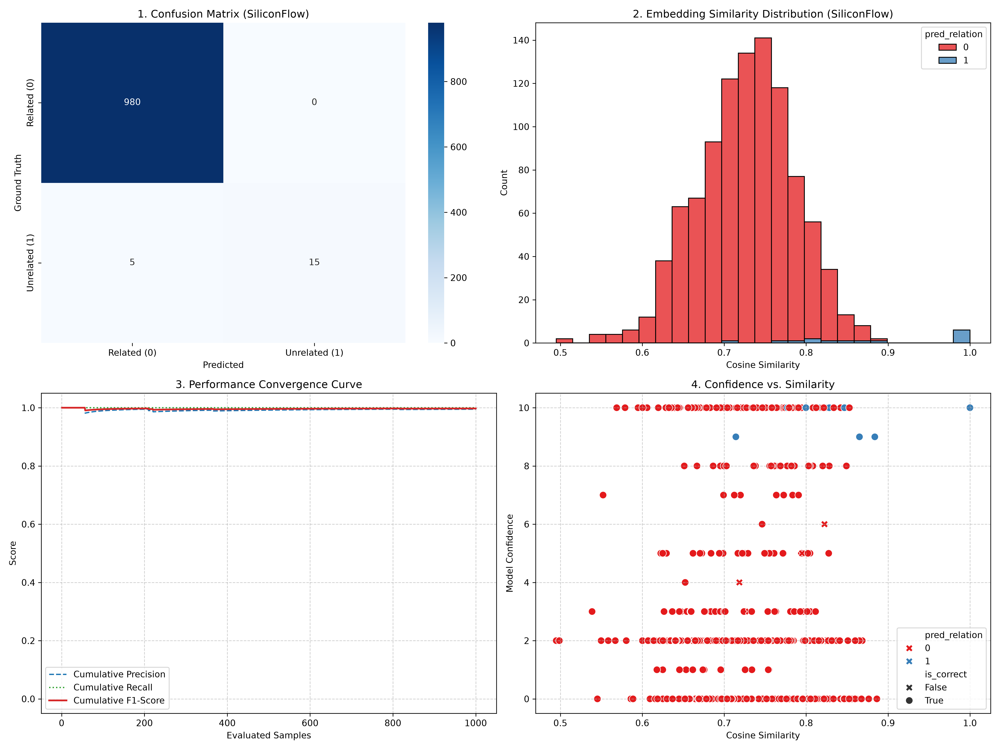
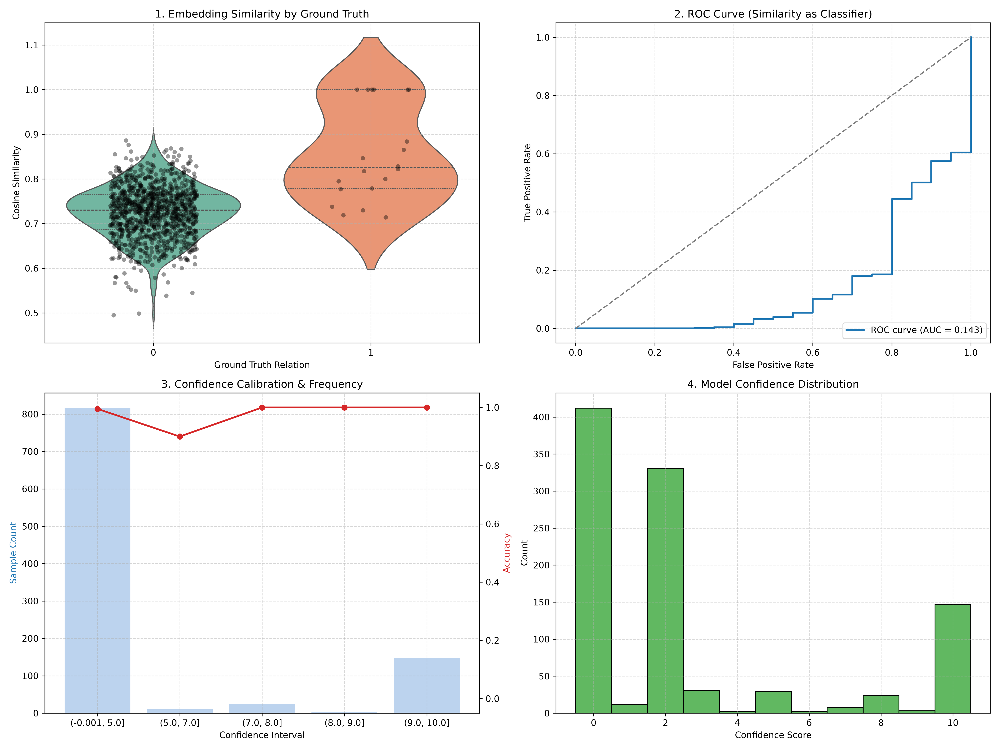

# KROMA: Knowledge-driven Ontology Matching with Large Language Models (Reproduction & Enhancements)

本仓库是针对知识驱动本体对齐框架 **KROMA** 的本地完整复现与工程增强版本。在原作者开源代码的基础上，本仓库补全了缺失的数据集预处理脚本，重构了大模型 API 路由与容错机制（支持 SiliconFlow 硅基流动等国内兼容端点），并新增了多源结果可视化分析看板。

---

## 🌟 复现亮点与工程改进 (Enhancements)

相比于原始仓库，本项目主要做了以下关键补充与系统加固：

1. **补全数据集构建工具链**：
   - 新增 `prepare_envo_sweet.py` 与 `build_dicts.py`，提供完整的 OAEI Biodiv（`ENVO ↔ SWEET`）本体词汇字典构建与对齐样本生成逻辑，支持开箱即用。
2. **多服务商自动路由与超时防御 (`chat_providers.py`)**：
   - 支持依据 API Key 前缀（`gsk_` 对应 Groq，`sk-` 对应 SiliconFlow / OpenAI）自动路由请求端点，无需反复修改源代码。
   - 针对大规模连续推理中的网络挂起问题，在客户端底层引入显式 `timeout=30.0` 限制，配合指数退避与随机抖动重试机制（Exponential Backoff + Jitter），保障千级样本评测的稳定性。
   - 保留增量状态落盘（`already done` 断点续跑），意外中断后可无缝继续。
3. **交互式多源可视化分析看板 (`result-graph.py`)**：
   - 编写了交互式评估脚本，支持一键切换 Groq、SiliconFlow 或自定义 `.jsonl` 评测结果。
   - 自动清洗数据并生成包含混淆矩阵、余弦相似度分布、指标收敛曲线、置信度校准（Confidence Calibration）及 ROC 曲线在内的 8 项核心分析子图。

---

## 📁 目录结构说明

```text
├── build_dicts.py                 # [新增] 本体字典抽取脚本
├── prepare_envo_sweet.py          # [新增] ENVO-SWEET 数据集预处理脚本
├── result-graph.py                # [新增] 交互式多源评估与 8 子图可视化看板
├── experiments/
│   ├── configs/
│   │   └── method/openai/
│   │       └── kroma_scibert_envo_sweet_silicon.jsonl  # [新增] SiliconFlow 模型配置文件
│   └── dataset/OAEI/Biodiv/       # [补全] 预处理完成的 ENVO/SWEET 字典与评测样本
├── figures/                       # [新增] 复现实验高清可视化评估看板
├── scripts/                       # 批量运行脚本
├── src/kroma/                     # KROMA 核心框架源码（含重构后的 model_providers）
├── .env.example                   # 环境变量配置模板
├── pyproject.toml                 # 项目依赖与打包配置
└── requirements.txt               # Python 依赖列表
```

---

## 🛠️ 快速开始 (Quick Start)

### 1. 环境安装

建议使用 Python 3.10+ 并创建独立虚拟环境：

```bash
# 创建并激活虚拟环境 (Windows Git Bash 示例)
python -m venv .venv
source .venv/Scripts/activate

# 安装项目及依赖
pip install -e .
pip install -r requirements.txt
```

### 2. 配置 API 密钥

复制 `.env.example` 为 `.env`，并填入你的 API Key（如使用国内无障碍访问的 SiliconFlow 硅基流动）：

```bash
cp .env.example .env
```

在 `.env` 文件中配置：

```env
# SiliconFlow (硅基流动) 配置示例
OPENAI_API_KEY=sk-你的硅基流动API密钥
OPENAI_BASE_URL=https://api.siliconflow.cn/v1

# 如需切换回 Groq，可使用以下配置：
# OPENAI_API_KEY=gsk_你的GroqAPI密钥
# OPENAI_BASE_URL=https://api.groq.com/openai/v1
```

### 3. 运行本体对齐评测

以 `ENVO ↔ SWEET` 数据集为例，使用 SiliconFlow 托管的 `Qwen/Qwen2.5-7B-Instruct` 运行基准评测：

```bash
kroma run \
  --method_config kroma_scibert_envo_sweet_silicon \
  --llm openai \
  --baseline
```

评测结果将实时增量保存至 `results/baseline/envo_sweet/` 目录下。

### 4. 生成可视化分析看板

运行内置的交互式分析脚本，根据终端提示选择对应数据源（`1` 为 Groq，`2` 为 SiliconFlow，`3` 为自定义路径）：

```bash
python result-graph.py
```

---

## 📊 实验复现结果展示 (Experimental Results)

在 `envo_sweet`（1,000 组概念对）上的完整评测表明：
- **硬负例甄别能力**：粗筛阶段留下的不相关概念对在 SciBERT 向量空间中具有较高的字面相似度，单纯依赖向量距离分类极易产生误判；
- **LLM 裁判收益**：引入 `Qwen2.5-7B-Instruct` 进行语义推理裁决后，模型在保持相关概念 $100\%$ 召回的同时，精准剔除了大量高相似度干扰负例，综合准确率达到 **$99.5\%$**（$F_1 \approx 0.997$）。

### 1. 基础性能监控看板 (Full Dashboard)


### 2. 进阶判别与置信度校准看板 (Advanced Dashboard)


---

## 📝 上传与安全提示

- 仓库中已完全移除包含个人真实密钥的 `.env` 文件。
- 如果在本地重新生成了 `.idea/`、`__pycache__/` 或 `*.egg-info/` 等缓存文件，`.gitignore` 会自动将其忽略，请勿手动强制提交。